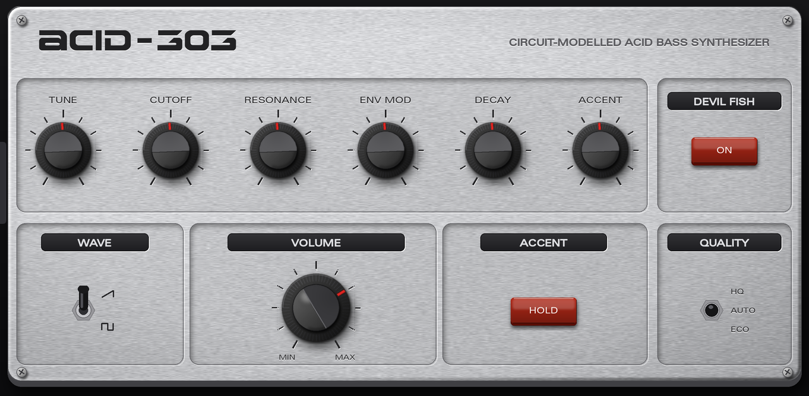
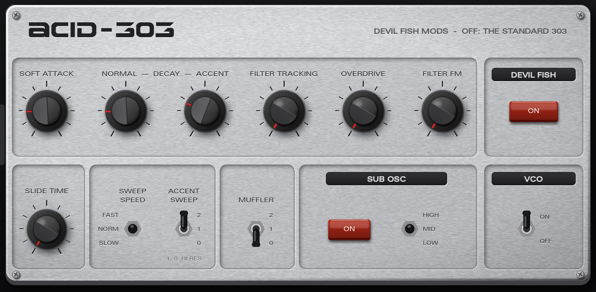

# Acid-303

A TB-303 bass synthesizer for the Akai MPC and Force standalone, built as a native VST2 plugin. Its voice is a
component-level **circuit model** of the original: the same transistors, diodes, capacitors and pots as Roland's
service-notes schematic. It also has the full set of **Devil Fish** mods, which you can switch in or out.




## Where it comes from

The voice is the TB-303 machine from **[Lemus](https://github.com/lemus-dev/lemus)** (v0.1.3, `machines/tb303`),
an instrument host by the Lemus authors, licensed under AGPL-3.0. Acid-303 uses the voice only, not Lemus's emulated
sequencer CPU, so you don't need any ROM. It is played from MIDI or from the MPC's own sequencer.

What Lemus models, and how closely it matches:

- **The whole voice, part by part, from the schematic:**
  - the pitch DAC and slide circuit;
  - the exponential VCO with its saw core and the Q8 square-wave shaper;
  - the four-capacitor transistor ladder filter, with the Q21 output amplifier inside its resonance loop;
  - the main and volume envelope generators, the accent sweep and the gate conditioning;
  - the BA662 VCA and the output stage.
- **Solved as circuits, not approximated with filters:** the nonlinear stages (ladder, square shaper, envelope
  transistors, VCA chip) are solved as circuit equations at every sample. That's why accent "wow", resonance, slide
  and note starts behave like the hardware.
- **Checked against SPICE:** each circuit block is compared with a SPICE simulation of the same netlist, and most
  agree to within fractions of a dB.
- **Fitted to a real unit:** the trims and the part values the schematic leaves open are fitted to 400 recorded notes
  from a real TB-303 (Din Sync's reference set). Against those notes:
  - **Lemus:** 3.0 dB average spectral distance;
  - **Roland's own TB-303 software:** 3.3 dB;
  - **the real 303 against its own retakes:** 2.2–2.5 dB.

## What changed to make it run on a Gen1 MPC or Force

As published, the Lemus voice needs about **117% of one Force CPU core**: it can't keep up in real time. Acid-303
brings it down to about **33%** in ECO mode and **43%** in HQ mode (one voice, 44.1 kHz, measured on a Force). How
much the sound moved was measured against renders from the original code on ten test patterns:

- **HQ:** at most 0.03 dB average spectral change, at most 0.2 dB in the single worst moment.
- **ECO:** at most 0.04 dB average, at most 0.26 dB in the single worst moment.

For scale, a real 303 differs from its own retakes by about 2.2 dB on the same measure.

What was changed, all in `src/lemus/` (the git history has one commit per step):

- **Faster maths, same results:**
  - fast inline `exp`, and `tanh`/`expm1`/`log1p` built from it (accurate to about 1e-14);
  - the filter's five transistor-pair `tanh`s done four at a time with NEON;
  - the square shaper's exponentials done as a pair.
- **Smarter solvers:**
  - each Newton solver stops once its remaining error is far below anything audible;
  - exact slopes in the envelope solvers instead of numerical ones;
  - a third-order starting guess for the filter;
  - the square shaper usually finishes in one step.
- **An error in the original fixed:** the VCA's current solver could stop early after an accented note's gate
  closed. It is now solved in the junction voltage, where it converges reliably.
- **Envelopes at an adaptive rate:** the gate, envelope and accent circuits run every sample for 25 ms after any
  note, accent or slide change, then every other sample to 40 ms, then every fourth. Note starts and releases are
  untouched.
- **ECO mode:**
  - the filter and VCA run at 2× instead of 4×;
  - the oscillator and square shaper stay at 384 kHz, so aliasing is unchanged;
  - the filter's resonance is frequency-corrected so it stays where 4× puts it.
- **Unused work skipped:** while SAW is selected, the square shaper only keeps its bias state.
- **Leaner downsampling:** shorter oscillator downsampling filters, with a delay that keeps the original's timing
  between oscillator and envelopes.

**CPU rating: WARN** (the repo's `tools/bench.sh`, on a Force, ECO, one instance, 44.1 kHz). Steady playing is about
19% of an audio block on average and 28–34% at the 99th percentile, which is the WARN band (p99 up to 35%): one or two
instances alongside a normal project, not a stack of them. An idle instance costs under 2%, because the voice sleeps
half a second after the last note. The bench's worst case, a random sweep of every control with all Devil Fish mods on
and QUALITY flipping between HQ and ECO, reaches about 42–50% p99, over the WARN limit; ordinary use doesn't do that.
HQ costs more again (about 43% of a core). If a project glitches, use ECO and fewer instances.

Gen2 devices (MPC Live III, Key 37 and other aarch64 models) are faster and run **HQ**, the original's full 4×, by
default. Measured on a Live III with the same bench: about 8.5% of an audio block while playing, 15% at the 99th
percentile and 17% worst block through the control sweep (WARN, just over the PASS line). The aarch64 build flushes
denormals to zero while rendering, as Gen1's NEON does by itself; without it sweeps spiked past 3000%.

## Features

- **303 tab:** TUNE (±700 cents, as the service notes specify), CUTOFF, RESONANCE, ENV MOD, DECAY, ACCENT, WAVE
  (saw/square), VOLUME, an ACCENT HOLD key that accents every note, and QUALITY (HQ / AUTO / ECO).
- **DEVIL FISH tab**, Robin Whittle's mods as on the TD-3-MO. They are built into the circuit model and checked
  against the figures in the Devil Fish manual:
  - **DEVIL FISH on/off.** Off is the standard 303, unchanged. On, CUTOFF reaches about an octave further each way,
    ENV MOD has three times the range and goes down to zero, and DECAY sets the volume envelope (16 ms to 3 s, then a
    sustain level).
  - **SOFT ATTACK**, 0.3–30 ms for non-accented notes. Notes start within 0.5 ms, and release decays smoothly from
    the end of the gate.
  - **NORMAL DECAY** and **ACCENT DECAY**, 30 ms to 3 s each.
  - **FILTER TRACKING**, up to 2.7 kHz per volt.
  - **OVERDRIVE**, the oscillator into the filter at up to 66.6× normal.
  - **SLIDE TIME**, 60–360 ms.
  - **FILTER FM**, the VCA's output modulating the filter.
  - **SWEEP SPEED** (fast / normal / slow), **ACCENT SWEEP** (0 / 1 / 2, with high resonance on 0 and 1) and
    **MUFFLER** (off / 1 / 2).
  - Fuller bass: 32 Hz is down 1 dB instead of 5.
  - From the TD-3-MO: a **SUB OSC** (square, an octave down; low / mid / high) and a **VCO OFF** switch, for the sub
    or the self-oscillating filter on its own.

  The Devil Fish circuit was never published, so the sweep-speed capacitor values and the muffler's clipping shape
  are informed estimates that behave as the manual describes. Everything else follows the manual's figures. With the
  mods off nothing of them is in the signal path.
- **Defaults:** every Devil Fish knob starts at the manual's "standard TB-303" setting, so switching the mods on
  doesn't jump the sound.
- **Q-Links** on both tabs, the knobs first. Settings are saved with the project.

## Playing it

Put Acid-303 on a plugin track, then play it from pads, a keyboard or the MPC sequencer:

- **Accent:** velocity 100 or more (or ACCENT HOLD on).
- **Slide:** start a note before the previous one ends. The new note glides there without retriggering, through the
  original slide circuit. Releasing the newest of several held notes slides back to the one before. CC65 (sustain /
  portamento) also makes the next note slide while the gate is up.
- **From the Acid sequencer:** Acid's notes already carry accent (velocity) and slide (overlap plus CC65), so routing
  its MIDI output to an Acid-303 track plays the patterns as intended.
- **Classic acid line:**
  1. Start with DECAY low, ENV MOD high and RESONANCE high.
  2. Ride CUTOFF.
  3. Turn up ACCENT to make the accented notes shout.
- **More:** turn on DEVIL FISH for longer or shorter envelopes, OVERDRIVE, FILTER FM and the sub.

QUALITY: leave it on **AUTO** (ECO on Gen1, HQ on Gen2). HQ on a Gen1 device costs about 43% of a core per instance.

## Installing

Download the release zip for your device (`gen1` for MPC Live/One/X/Key 61 and Force, `gen2` for aarch64 models),
unzip it and run its `install.sh` as described in the included `INSTALL.md`. It copies the plugin folder to
`/sdcard/Synths`, registers the plugin and restarts MPC. Then Acid-303 appears among the plugin instruments.

## Building

```sh
MPC_VST=/path/to/mpc-vst-plugins vst/build.sh      # Gen1 (armv7) and Gen2 (aarch64) plugin + skin
python3 skin/make_skin.py vst/                     # redraw the skin (Pillow)
tools/voicetest/build.sh && tools/voicetest/tbtest check tools/voicetest/golden   # voice vs the original renders
```

## Credits and licence

- **Voice:** [Lemus](https://github.com/lemus-dev/lemus) TB-303 machine, AGPL-3.0. Acid-303 is a modified version
  and is AGPL-3.0 too (`LICENSE`); its source is this repository.
- **Devil Fish:** the mods are by Robin Whittle (firstpr.com.au). Their behaviour is taken from his Devil Fish manual.
- **Accent and slide over MIDI:** follows the convention of Roland's TB-303 software, the TB-03/TD-3 and Open303.
- **Plugin wrapper and skin tools:** [mpc-vst-plugins](https://github.com/sd88me/mpc-vst-plugins).
- **Fonts:** Univers 53 Extended and Earth Normal, as in the Acid sequencer (see `skin/assets/FONTS.md`).
- **Skin:** drawn from scratch.

TB-303 and TB-03 are Roland products and TD-3/TD-3-MO are Behringer's. Acid-303 is not affiliated with Roland,
Behringer, the Lemus authors or Robin Whittle. The names only describe what is modelled.
